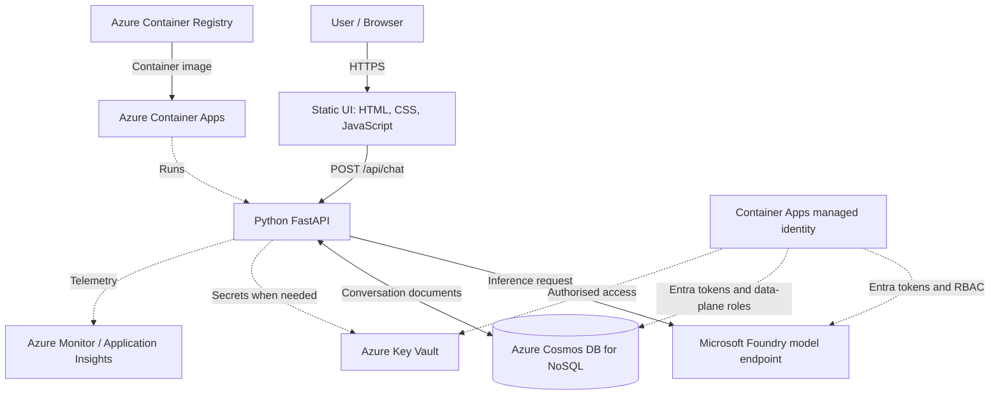

# omi.

**A little space to think.**

> **Status:** In development · **Version:** 0.1.0 · **Stack:** Python, FastAPI, Microsoft Azure

omi is a minimalist, cloud-native conversational AI application. Its interface is intentionally quiet and simple; its backend is designed to demonstrate the engineering behind a real AI product: model inference, REST APIs, identity-based authentication, persistence, container deployment, and observability.

This repository is also a practical Azure AI and cloud learning lab. It is **not** a claim that every service shown below is already deployed.

## Contents

- [What omi does](#what-omi-does)
- [Implementation status](#implementation-status)
- [System architecture](#system-architecture)
- [Technology stack](#technology-stack)
- [Repository layout](#repository-layout)
- [Local development](#local-development)
- [Configuration](#configuration)
- [API design](#api-design)
- [Conversation data model](#conversation-data-model)
- [Identity and security](#identity-and-security)
- [Azure provisioning and deployment](#azure-provisioning-and-deployment)
- [Docker](#docker)
- [Testing and observability](#testing-and-observability)
- [Reliability and cost](#reliability-and-cost)
- [Roadmap](#roadmap)
- [Troubleshooting](#troubleshooting)
- [Author](#author)

## What omi does

The intended experience is a clean, browser-based AI conversation space. Users can submit messages, receive model-generated answers, and return to previous conversations. The application backend handles communication with the model and, when enabled, saves messages to Azure Cosmos DB.

**Design principles:**

1. **Calm by default.** Minimal interface, legible typography, restrained colour.
2. **Simple outside, engineered inside.** Hide cloud complexity from the user.
3. **Secure by design.** Prefer managed identity over embedded API keys.
4. **Learn through implementation.** Every Azure resource has a specific job.

**Out of scope for the initial version:** user accounts, payments, file uploads, voice, autonomous agents, retrieval-augmented generation, and multi-tenant enterprise features.

## Implementation status

The initial scaffold described in this repository contains a FastAPI app, a static HTML/CSS/JavaScript interface, dependency definitions, and container scaffolding. **The starter chat form is not yet connected to an AI model.** Empty integration modules are placeholders until implemented.

| Capability | Status |
| --- | --- |
| FastAPI application and health endpoint | Scaffolded |
| Minimal browser interface | Scaffolded |
| Dockerfile and requirements | Scaffolded |
| AI inference endpoint | Planned |
| Chat conversation persistence | Planned |
| Managed identity and RBAC | Planned |
| Key Vault integration | Planned / optional |
| Azure Container Apps deployment | Planned |
| Application Insights telemetry | Planned |
| Automated tests and CI/CD | Planned |

Update this table as functionality is merged; do not interpret the architecture below as an inventory of deployed services.

## System architecture



The browser talks only to the FastAPI application. It must never receive Azure credentials. The backend sends model requests and handles persistence. Azure Container Apps hosts the packaged application; Azure Container Registry stores its image. A managed identity provides workload credentials, not an extra application server.

### Request lifecycle (target)

1. The user enters a message in the browser.
2. JavaScript sends an HTTPS request to `POST /api/chat`.
3. FastAPI validates the payload and applies request limits.
4. The backend loads recent history from Cosmos DB, if persistence is enabled.
5. The backend sends the message and relevant history to the configured model deployment.
6. The model returns a response; FastAPI saves the exchange if persistence is enabled.
7. FastAPI returns a structured JSON response to the browser.
8. Application telemetry records timing, failures, and service health **without recording sensitive prompt content by default**.

## Technology stack

| Layer | Technology | Responsibility |
| --- | --- | --- |
| Interface | HTML, CSS, JavaScript | Minimal chat UI |
| Application | Python 3.12+, FastAPI | HTTP endpoints, orchestration, validation |
| ASGI server | Uvicorn | Serve FastAPI |
| AI | Microsoft Foundry + compatible model endpoint | Text generation |
| AI client | OpenAI Python SDK for compatible endpoints | Model inference requests |
| Persistence | Azure Cosmos DB for NoSQL | Conversations and messages |
| Authentication | Microsoft Entra ID, `azure-identity` | Developer and workload credentials |
| Secrets | Azure Key Vault | Secrets that cannot use identity-based auth |
| Packaging | Docker | Portable runtime image |
| Registry | Azure Container Registry | Image storage |
| Hosting | Azure Container Apps | Managed container execution |
| Telemetry | Azure Monitor / Application Insights | Logs, traces, metrics |
| Testing | pytest, HTTPX | Unit and API tests |

The exact model SDK and endpoint format depend on the deployment type selected in Foundry. The sample configuration below assumes an **Azure OpenAI-compatible v1 endpoint**; other Foundry model endpoints may require a different client.

## Repository layout

```text
omi/
├── app/
│   ├── __init__.py
│   ├── main.py                  # FastAPI app and static routes
│   ├── api/
│   │   ├── __init__.py
│   │   └── chat.py              # Planned chat API
│   ├── core/
│   │   ├── __init__.py
│   │   ├── config.py            # Planned configuration management
│   │   └── identity.py          # Planned credential provider
│   ├── models/
│   │   ├── __init__.py
│   │   └── schemas.py           # Planned request/response schemas
│   └── services/
│       ├── __init__.py
│       ├── ai_service.py        # Planned model client
│       ├── cosmos_service.py    # Planned conversation persistence
│       └── keyvault_service.py # Optional secret retrieval
├── static/
│   ├── assets/
│   ├── index.html
│   ├── style.css
│   └── app.js
├── tests/
│   ├── __init__.py
│   └── test_chat.py             # Planned tests
├── docs/
├── Dockerfile
├── requirements.txt
├── .env.example
├── .dockerignore
├── .gitignore
└── README.md
```

## Local development

### Prerequisites

- Python 3.12 or newer
- Git
- Docker (optional for local development)
- Azure CLI (when testing Azure integrations)
- An Azure subscription with permissions to create resources (for deployment)

### Clone and run

```bash
git clone https://github.com/mosamapodile/omi.git
cd omi
python3 -m venv .venv
source .venv/bin/activate
pip install -r requirements.txt
cp .env.example .env
uvicorn app.main:app --reload
```

Open **http://localhost:8000**. The health endpoint is **http://localhost:8000/api/health** and FastAPI documentation is **http://localhost:8000/docs**.

The initial scaffold serves the interface and health endpoint only. Sending a message in the initial UI does **not** produce a model response until the chat route and frontend fetch logic are implemented.

For local Azure authentication, after installing Azure CLI:

```bash
az login
az account show
```

`DefaultAzureCredential` can use the signed-in developer identity locally. This identity still needs the relevant resource permissions.

## Configuration

Copy `.env.example` to `.env`. Use resource values from Azure Portal; do not commit `.env` or credentials.

```dotenv
APP_ENV=development

# Model deployment (Azure OpenAI-compatible v1 endpoint)
AZURE_OPENAI_ENDPOINT=https://YOUR-RESOURCE.openai.azure.com/openai/v1/
AZURE_OPENAI_DEPLOYMENT=YOUR-DEPLOYMENT-NAME

# Cosmos DB for NoSQL
COSMOS_ENDPOINT=https://YOUR-ACCOUNT.documents.azure.com:443/
COSMOS_DATABASE=omi
COSMOS_CONTAINER=conversations

# Optional Key Vault
KEY_VAULT_URL=https://YOUR-VAULT.vault.azure.net/
```

| Variable | Meaning | Required when |
| --- | --- | --- |
| `APP_ENV` | Environment label | Always |
| `AZURE_OPENAI_ENDPOINT` | Compatible model API base URL | AI inference enabled |
| `AZURE_OPENAI_DEPLOYMENT` | Deployed model name | AI inference enabled |
| `COSMOS_ENDPOINT` | Cosmos DB account endpoint | Persistence enabled |
| `COSMOS_DATABASE` | Database name | Persistence enabled |
| `COSMOS_CONTAINER` | Container name | Persistence enabled |
| `KEY_VAULT_URL` | Vault endpoint | Key Vault integration enabled |

Use Azure Container Apps environment variables for non-secret settings. Use managed identity wherever supported and Key Vault references for secrets that genuinely must be stored.

## API design

### Implemented in the starter scaffold

**`GET /api/health`**

Example response:

```json
{
  "status": "healthy",
  "application": "omi"
}
```

This is a basic liveness endpoint; it does not verify that Azure dependencies are reachable.

**`GET /`** serves the web interface. **`/static/*`** serves frontend assets.

### Proposed chat API (not yet implemented)

**`POST /api/chat`**

Request:

```json
{
  "conversation_id": "f5b6f4d4-93a1-4f76-9336-b14586db8c13",
  "message": "Explain managed identities in Azure."
}
```

Response:

```json
{
  "conversation_id": "f5b6f4d4-93a1-4f76-9336-b14586db8c13",
  "message_id": "58e1ad2c-1138-4e21-9b44-bbb4c51231b1",
  "reply": "A managed identity lets an Azure-hosted application obtain credentials without storing a password."
}
```

For a new conversation, the API may accept `conversation_id: null` and generate an ID. The backend, not the browser, determines which data a caller is permitted to access.

### Proposed additional endpoints

| Method | Route | Purpose |
| --- | --- | --- |
| `GET` | `/api/conversations` | List the caller's conversations |
| `GET` | `/api/conversations/{id}` | Retrieve messages in one conversation |
| `DELETE` | `/api/conversations/{id}` | Delete a conversation |
| `GET` | `/api/ready` | Check dependency readiness |

These endpoints require a defined user/session ownership model before public deployment.

### Error behaviour (target)

- `400` — malformed or unsupported input
- `401` / `403` — unauthenticated or unauthorised access, if auth is enabled
- `404` — conversation not found or inaccessible
- `429` — request quota/rate limit reached
- `502` / `503` — model or database dependency unavailable
- `500` — unexpected server error (without leaking credentials or internals)

Use bounded request sizes, model timeouts, retry policies for transient failures, and consistent response schemas.

## Conversation data model

**Proposed database:** `omi`  
**Proposed container:** `conversations`  
**Proposed partition key:** `/userId`

Example conversation document:

```json
{
  "id": "f5b6f4d4-93a1-4f76-9336-b14586db8c13",
  "userId": "user-123",
  "title": "Learning Azure",
  "createdAt": "2026-10-15T12:00:00Z",
  "updatedAt": "2026-10-15T12:03:00Z",
  "messages": [
    {
      "id": "msg-001",
      "role": "user",
      "content": "What is Azure Container Apps?",
      "createdAt": "2026-10-15T12:00:00Z"
    },
    {
      "id": "msg-002",
      "role": "assistant",
      "content": "Azure Container Apps is a managed service for running containerised applications.",
      "createdAt": "2026-10-15T12:00:02Z"
    }
  ]
}
```

**Important design decision:** this example is convenient for small conversations, but a single growing document has size and write-contention limits. For a larger application, store individual messages as separate documents and use a suitable partition strategy.

**Identity caveat:** `/userId` is meaningful only after a real authentication or session mechanism exists. Do not accept arbitrary `userId` values from an unauthenticated browser and treat them as secure ownership. Until authentication is implemented, treat omi as a single-user local development application or disable public history endpoints.

**Privacy:** establish a retention period, delete behaviour, and a policy for handling prompt content before inviting real users.

## Identity and security

### Preferred authentication flow

```text
Local development:
Azure CLI sign-in → DefaultAzureCredential → Entra token → Azure service

Azure deployment:
Container Apps managed identity → Entra token → Azure service
```

Use `azure-identity` and `DefaultAzureCredential` so the application can use developer credentials locally and managed identity when deployed. Assign only the permissions each resource requires.

| Resource | Example access required | Notes |
| --- | --- | --- |
| Model inference | Azure AI inference role appropriate to the deployment | Confirm the model resource's supported RBAC roles |
| Cosmos DB for NoSQL | Cosmos DB Built-in Data Contributor (data-plane) | Cosmos data-plane RBAC is distinct from Azure management-plane IAM |
| Key Vault | Key Vault Secrets User when reading secrets | Only if the app actually needs secrets |
| Container Registry | Image-pull permission for Container Apps identity | Configure registry authentication during deployment |

**Security baseline:**

- Never expose API keys or credentials in frontend JavaScript.
- Never commit `.env`, tokens, connection strings, or secrets.
- Prefer Entra tokens and managed identity over long-lived keys.
- Restrict CORS to known origins if cross-origin requests are required.
- Enforce HTTPS for public endpoints.
- Apply input-size limits and rate limiting before public exposure.
- Avoid logging complete prompts or model outputs by default.
- Do not expose conversation history without caller ownership checks.

## Azure provisioning and deployment

Create resources through **Azure Portal** in the following order. Exact portal labels and availability can change by region and account type.

### 1. Resource group

Create a development resource group, for example `rg-omi-dev`, and keep related resources together for visibility and cleanup.

### 2. Model deployment

In Microsoft Foundry, create or select a model deployment. Record its **endpoint**, **deployment name**, supported API format, and required permissions. Test inference locally before adding other services.

### 3. Cosmos DB for NoSQL

Create an account, database `omi`, and container `conversations` with the planned partition key. Copy the account endpoint. Grant the local developer identity appropriate Cosmos DB **data-plane** access.

### 4. Container Registry

Create a registry such as `omiacr` (the actual name must be available). Build and push the Docker image using Docker or an Azure build workflow.

### 5. Container Apps

Create a Container Apps environment and an app such as `omi-api`. Configure:

- Container image from the registry
- Target port **8000**
- External ingress only if browser access is intended
- Environment variables from the configuration table
- System-assigned managed identity
- Image-pull permissions for the registry
- Appropriate AI and Cosmos DB permissions

### 6. Key Vault (optional)

Create a vault only if omi has secrets that cannot be replaced with managed identity. Grant the app identity read access and reference secrets securely.

### 7. Monitoring

Connect Azure Monitor/Application Insights or the supported Container Apps telemetry path. Inspect application errors, request duration, dependencies, and container logs.

### 8. Verification

After deployment, check:

1. `GET /api/health` responds successfully.
2. The browser loads over HTTPS.
3. The app can call the deployed model.
4. A test conversation can be written and read from Cosmos DB.
5. No credentials are exposed to the browser or logs.
6. Logs show expected request and dependency activity.

## Docker

Build locally:

```bash
docker build -t omi:latest .
```

Run the **starter scaffold** locally:

```bash
docker run --rm -p 8000:8000 omi:latest
```

Once Azure integrations are implemented, the container also needs configuration and an authentication strategy. Passing an `.env` file alone does not provide Azure identity credentials. On Azure Container Apps, use managed identity. For local container testing, use a supported developer credential method rather than baking secrets into the image.

## Testing and observability

### Test plan

| Test | Expected result |
| --- | --- |
| Health route | HTTP 200 with application status |
| Empty message | Request rejected with validation error |
| Valid chat message | Model response returned in agreed schema |
| Model timeout | Controlled error, no hanging request |
| Cosmos write/read | Conversation can be persisted and retrieved |
| Missing Azure permission | Clear server-side error without leaked credentials |
| Invalid conversation ownership | Access denied |
| Container startup | App listens on configured port |

Run automated tests once implemented:

```bash
pytest -q
```

The initial test files are placeholders; this command does not imply meaningful coverage until tests are added.

### Observability goals

Capture request counts, latency, dependency failures, exception rates, container restarts, and estimated model usage/cost where available. Use correlation IDs to connect requests to backend events. Do not record user conversation text as ordinary diagnostic telemetry.

## Reliability and cost

This is a learning project, so start with a single environment and the smallest practical deployment.

- Model inference may be billed per token or deployment capacity.
- Cosmos DB costs depend on throughput, storage, and chosen pricing mode.
- Container Apps and Container Registry may incur runtime, storage, and network charges.
- Logging ingestion and retention can also cost money.
- Use Azure Cost Management budgets and alerts.
- Delete unused resources after experiments; stopping the app may not eliminate every charge.

For a robust application, add request timeouts, limited retries with backoff, error handling for quota exhaustion, health/readiness checks, and backup/retention decisions.

## Roadmap

### Phase 1 — Foundation

- [x] Initialise repository structure
- [x] Create FastAPI application and basic health route
- [x] Create minimal browser interface
- [x] Add Docker and dependency scaffolding
- [ ] Add initial automated tests

### Phase 2 — AI conversation

- [ ] Deploy/select a compatible Foundry model
- [ ] Implement AI service client
- [ ] Implement `POST /api/chat`
- [ ] Connect the browser form to the API
- [ ] Add validation, timeouts, and error states

### Phase 3 — Persistence and identity

- [ ] Provision Cosmos DB
- [ ] Implement conversation storage
- [ ] Define a safe user/session ownership model
- [ ] Configure Entra permissions and managed identity
- [ ] Add Key Vault only if required

### Phase 4 — Cloud operations

- [ ] Build and push container image
- [ ] Deploy to Azure Container Apps
- [ ] Configure registry pull permissions and ingress
- [ ] Enable monitoring and investigate logs
- [ ] Add CI/CD and deployment checks

### Phase 5 — Product polish

- [ ] Refine accessibility and responsive design
- [ ] Add conversation browsing and deletion
- [ ] Add usage limits and cost safeguards
- [ ] Document deployment screenshots and lessons learned

## Troubleshooting

| Symptom | Likely cause | First check |
| --- | --- | --- |
| UI loads but chat does nothing | Chat endpoint/frontend integration not implemented | Check current implementation status |
| `401` from model endpoint | Missing/invalid token or wrong endpoint | Verify deployment API and credentials |
| `403` from model or Cosmos DB | Missing role assignment | Check service-specific data-plane permissions |
| `404` from model | Wrong deployment name or API path | Verify exact Foundry endpoint and deployment |
| Cosmos DB connection failure | Endpoint, network, or permissions issue | Verify endpoint, firewall, and data-plane RBAC |
| Container starts but site fails | Incorrect port or ingress | Confirm Uvicorn port 8000 and Container Apps target port |
| Works locally but fails in Azure | Different identity or missing environment variables | Inspect managed identity, RBAC, and app settings |
| Unexpected charges | Running resources, model usage, or logs | Review Cost Management and resource inventory |

## Learning outcomes

By completing omi, the project should demonstrate the ability to:

- Explain the separation between application code and cloud resources.
- Integrate a Python backend with a deployed language model.
- Use identity-based access to cloud services.
- Design a document-oriented conversation store.
- Package and run an application in a container.
- Deploy and observe a cloud-native service.
- Diagnose configuration, authentication, and dependency failures.

These outcomes overlap with practical Azure AI/cloud engineering skills, but **omi is not an exhaustive substitute for an official certification exam skills outline**.

## Author

**Mogau Mapodile**  
Software Engineering · Cloud Computing · AI Development  
GitHub: [@mosamapodile](https://github.com/mosamapodile)

---

<p align="center"><strong>omi.</strong><br><em>A little space to think.</em></p>
